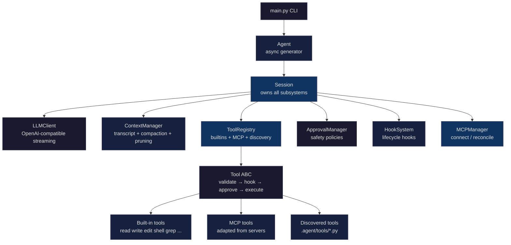

# AI Coding Agent

A terminal-native AI coding agent built in Python. Runs in your terminal, streams responses in real time, calls tools autonomously, and edits files — similar to Claude Code or OpenCode, but open and hackable.

## Quick Start

```bash
# Clone and install
git clone https://github.com/<you>/coding-agent.git
cd coding-agent
uv sync

# Configure
cp .env.example .env
# Edit .env: set API_KEY and BASE_URL (e.g., https://api.groq.com/openai/v1)

# Run
uv run agent                    # interactive TUI
uv run agent "explain this repo"  # single run
uv run agent --cwd ./some/dir    # operate in another directory
```

## Configuration

### Environment variables (`.env`)

| Variable | Required | Description |
|---|---|---|
| `API_KEY` | Yes | Any OpenAI-compatible provider key |
| `BASE_URL` | No | Provider endpoint (default: OpenAI) |

### Per-project config (`.agent/config.json`)

```json
{
  "hooks_enabled": false,
  "approval": "auto",
  "model": {
    "temperature": 0.5,
    "name": "openai/gpt-oss-20b"
  },
  "mcp_servers": {
    "filesystem": {
      "enabled": true,
      "command": "npx",
      "args": ["-y", "@modelcontextprotocol/server-filesystem", ".", "/tmp"]
    }
  }
}
```

User-level config: `~/.config/ai-agent/config.json` (merged over by project config).

### Developer instructions

Place an `AGENT.MD` file in your project root. Its contents are injected into the system prompt as developer instructions.

## Architecture



The agent loop runs turn-by-turn: compress if needed → stream from LLM → execute tools → prune → repeat. Config changes land between turns, never during (turn-atomic). See [docs/arch.md](docs/arch.md) for full details.

## Features

### Core
- Interactive and single-run modes
- Streaming text responses with real-time display
- Multi-turn conversations with tool calling
- Configurable model, temperature, and context window
- Any OpenAI-compatible provider (Groq, OpenRouter, OpenAI, etc.)

### Built-in Tools
- **File operations:** read, write, edit, apply_patch (batched multi-file)
- **Directory operations:** list, glob patterns
- **Text search:** grep with regex support
- **Shell execution:** run commands with safety checks
- **Web access:** search and fetch
- **Memory:** store and retrieve user preferences
- **Todo:** task list management
- **Subagents:** codebase investigator, code reviewer

### Context Management
- Automatic compaction when approaching token limits
- Tool output pruning (keeps recent, clears old)
- Token usage tracking (provider + local fallback)
- Prompt caching (stable prefix for provider cache hits)

### Safety & Approval
- Approval policies: `on-request`, `auto`, `never`, `yolo`, `auto-edit`, `on-failure`
- Dangerous command detection and blocking (hard block, no policy override)
- Path-based safety checks (operations outside cwd require confirmation)
- User confirmation prompts for mutating operations

### Session Management
- Save and resume sessions
- Create and restore checkpoints
- Persistent session storage (`~/.local/share/ai-agent/`)

### MCP Integration
- Connect to MCP servers (stdio and HTTP/SSE)
- Auto-discover and adapt MCP tools
- `/refresh` to reconnect mid-session

### Configuration
- Layered config: global + per-project
- Live reload via `/refresh` (no restart needed)
- Turn-atomic application (config never changes mid-turn)
- Developer instructions via `AGENT.MD`

### User Interface
- Terminal TUI with streaming output
- Slash commands: `/help`, `/config`, `/approval`, `/model`, `/tools`, `/mcp`, `/stats`, `/save`, `/resume`, `/checkpoint`, `/restore`, `/sessions`, `/refresh`, `/clear`, `/exit`

## Commands

| Command | Description |
|---|---|
| `/help` | Show help |
| `/config` | Show current configuration |
| `/approval <mode>` | Change approval policy |
| `/model <name>` | Change model |
| `/tools` | List available tools |
| `/mcp` | Show MCP server status |
| `/stats` | Session statistics |
| `/save` | Save session |
| `/sessions` | List saved sessions |
| `/resume <id>` | Resume a session |
| `/checkpoint` | Create a checkpoint |
| `/restore <id>` | Restore a checkpoint |
| `/refresh` | Reload config from disk |
| `/clear` | Clear conversation |
| `/exit` | Quit |

## Development

```bash
uv run pytest              # 29 tests
uv run ruff check .        # lint
uv run ruff format .       # format
uv sync --group dev        # reinstall dev deps
```

### Measurement tools
```bash
uv run python -m scripts.bench_turn        # context efficiency benchmark
uv run python -m scripts.mock_provider    # offline stream_options proof
```

## Project Layout

```
main.py              CLI entrypoint (exposed as `agent`)
agent/               Agent loop, session, events, persistence
client/              LLM client (OpenAI-compatible) and stream types
config/              Config model and layered config loading
context/             Context manager, compaction, loop detection
tools/               Tool base classes, registry, discovery, MCP
  builtin/           Built-in tools
  mcp/               MCP client, manager, tool adapter
ui/                  Terminal UI
utils/               Paths, text, errors
hooks/               Pre/post tool and agent hooks
safety/              Approval policies
prompts/             System prompt
scripts/             Dev measurement tools
tests/               Test suite
docs/                Architecture and design docs
```

## Dependencies

| Package | Purpose |
|---|---|
| `openai` | LLM client (OpenAI-compatible) |
| `pydantic` | Config validation, tool schemas |
| `httpx` | HTTP transport |
| `rich` | Terminal UI |
| `tiktoken` | Token counting |
| `platformdirs` | Cross-platform paths |
| `fastmcp` | MCP client |
| `ddgs` | Web search |
| `click` | CLI framework |

## License

MIT