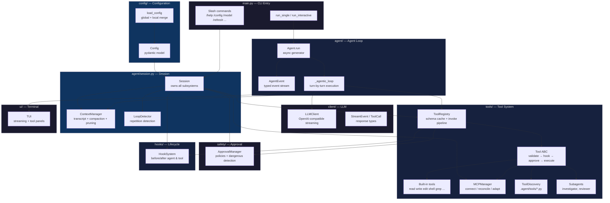
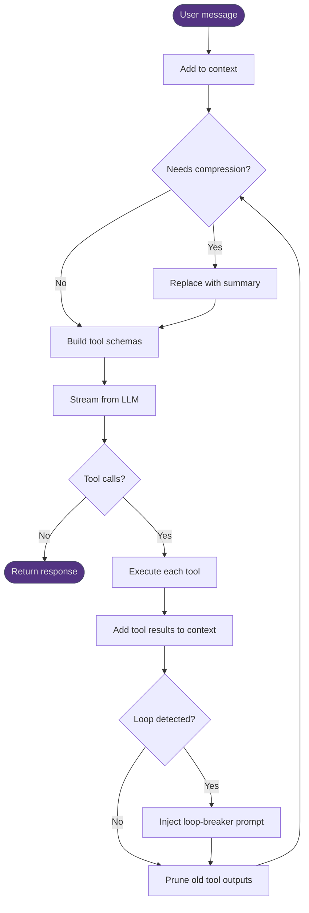

# Architecture

This document describes the architecture of the AI Coding Agent. For setup and usage, see [README.md](../README.md).

## Overview

A terminal-native AI coding agent built in Python. The core is an async generator-based agent loop that streams responses, calls tools, and manages context automatically. Inspired by Claude Code and OpenCode, but open and hackable.

## High-Level Architecture



## Agent Loop

The core loop in `agent/agent.py:_agentic_loop()`:



**Key rules:**
- A turn is atomic. Config changes land between turns, never during.
- The transcript is append-only. Only compaction (wipes everything) and pruning (blanks old content) reduce it.
- Tool results must immediately follow the assistant message that requested them (OpenAI protocol).

## Component Descriptions

### Agent (`agent/agent.py`)
Async generator yielding `AgentEvent` types. `run()` wraps `_agentic_loop()`. Events: `AGENT_START`, `TEXT_DELTA`, `TEXT_COMPLETE`, `TOOL_CALL_START`, `TOOL_CALL_COMPLETE`, `AGENT_ERROR`, `AGENT_END`.

### Session (`agent/session.py`)
Owns all subsystems. `initialize()` connects MCP, discovers tools, builds context manager. `reconcile()` applies config changes without wiping conversation.

### ContextManager (`context/manager.py`)
Stores the transcript as `list[MessageItem]`. Converts to OpenAI-shaped dicts via `get_messages()`. Handles:
- `needs_compression()` — checks usage against context window
- `replace_with_summary()` — compacts transcript (lossy, irreversible)
- `prune_tool_outputs()` — clears old tool results beyond a token budget
- Local token accounting as fallback when provider omits usage

### LLMClient (`client/llm_client.py`)
OpenAI-compatible streaming client. Handles retries, rate limits, connection errors. Sends `stream_options={"include_usage": True}` to get token counts. Memoizes tool wire-format.

### ToolRegistry (`tools/registry.py`)
Registers built-in, MCP, and discovered tools. Memoizes OpenAI schemas. Invoke pipeline: validate → before_tool hook → approval gate → execute → after_tool hook.

### MCPManager (`tools/mcp/mcp_manager.py`)
Connects to MCP servers (stdio/HTTP). Adapts remote tools as `MCPTool` instances. Supports per-server connect/disconnect for `/refresh`.

### ApprovalManager (`safety/approval.py`)
Policy-based approval: `on-request`, `auto`, `never`, `yolo`, `auto-edit`, `on-failure`. Dangerous commands are always rejected regardless of policy.

### HookSystem (`hooks/hook_system.py`)
Runs shell commands/scripts on lifecycle events: before/after agent, before/after tool, on error.

## Context Management

### Token accounting
Two sources: provider-reported (`_latest_usage`) and local estimate (`_local_transcript_tokens`). `effective_usage_tokens()` takes the max — so compaction works even when the provider omits usage.

### Compaction
When tokens exceed 80% of context window: send transcript to LLM for summarization, replace all messages with summary + synthetic ack + continue prompt. **Lossy and irreversible.**

### Pruning
Clears old tool outputs beyond a 6,000-token recent window. Replaces content with `"[tool output pruned to save context]"`. Idempotent (won't re-prune).

## Tool Pipeline

```
tool_call → validate_params (Pydantic)
         → before_tool hook
         → get_confirmation (if mutating)
         → approval_manager.check_approval()
         → execute(invocation)
         → after_tool hook
         → ToolResult
```

Tools normalize into a single `Tool` ABC. Built-ins, subagents, discovered `.py` files, and MCP tools all use the same pipeline.

## Config System

### Layering
1. `~/.config/ai-agent/config.json` (global)
2. `<project>/.agent/config.json` (local, overrides global)
3. Merged with `_merge_dicts()` (deep merge)

### Live reload
`/refresh` command: reload config → reconcile (diff old vs new) → patch only what changed. Turn-atomic: changes apply between turns, never during.

### Environment
- `API_KEY` (required), `BASE_URL` (optional, defaults to OpenAI)
- `.env` file loaded via `python-dotenv`

## Cache Strategy

| Cache | Key | Invalidated by |
|---|---|---|
| Tool schemas (`_schema_cache`) | None (computed once) | `register()`, `unregister()`, `register_mcp_tool()` |
| Wire format (`_tools_cache`) | List identity | New list object |
| System message (`_system_message`) | None (built once) | Never (structural) |
| Prefix tokens (`_system_prefix_tokens`) | None (memoized) | `on_model_changed()` |

## Dependencies

| Package | Purpose |
|---|---|
| `openai` | LLM client (OpenAI-compatible) |
| `pydantic` | Config validation, tool schemas |
| `httpx` | HTTP transport |
| `rich` | Terminal UI |
| `tiktoken` | Token counting |
| `platformdirs` | Cross-platform paths |
| `fastmcp` | MCP client |
| `ddgs` | Web search |
| `click` | CLI framework |

## Feature Checklist

- [x] Interactive and single-run modes
- [x] Streaming text responses
- [x] Multi-turn conversations with tool calling
- [x] Configurable model, temperature, context window
- [x] Any OpenAI-compatible provider
- [x] File operations (read, write, edit, apply_patch)
- [x] Shell execution with safety checks
- [x] Web search and fetch
- [x] Memory (user preferences)
- [x] Todo management
- [x] Subagents (investigator, reviewer)
- [x] Context compaction (LLM summarization)
- [x] Tool output pruning
- [x] Token usage tracking
- [x] Prompt caching (stable prefix)
- [x] Approval policies (6 modes)
- [x] Dangerous command detection
- [x] Path-based safety checks
- [x] Session save/resume
- [x] Checkpoints
- [x] MCP integration (stdio + HTTP)
- [x] Live config reload (/refresh)
- [x] Turn-atomic config application
- [x] Lifecycle hooks
- [x] Loop detection
- [x] Tool discovery (.agent/tools/*.py)
- [ ] File watcher (optional)
- [ ] Diff-based reconcile
- [ ] UI improvements (spinner, timing)