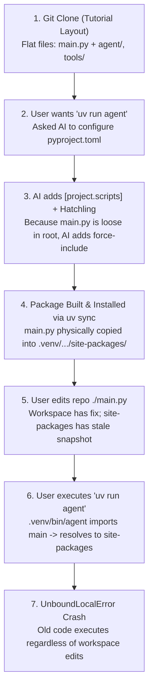
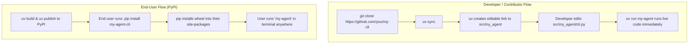

# Python Environments, Packaging, `sys.path`, and `uv` Guide

A comprehensive architectural reference and mental model for virtual environments, packaging backends, import resolution, and modern workflows with `uv`.

---

## 1. The Incident Chronology: How the Bug Happened

Understanding how flat scripts, packaging backends, and entry points interact explains why the `/restore` crash persisted despite source code edits.



### Step-by-Step Breakdown

1. **The Starting State**: You cloned a repository structured as a tutorial script rather than a standard Python package. `main.py` was sitting loose in the repository root alongside folders like `agent/`, `tools/`, and `config/`.
2. **The Convenience Request**: You wanted a clean command (`uv run agent`) instead of running `uv run python main.py`.
3. **The AI's Packaging Hack**: To support `[project.scripts] agent = "main:main"`, Python requires an installable package. Because standard tools expect all code inside a dedicated package directory, the AI introduced Hatchling and explicitly forced `main.py` into the wheel payload:
   ```toml
   [tool.hatch.build.targets.wheel.force-include]
   "main.py" = "main.py"
   ```
4. **The Silent Trap**: When `uv sync` executed, it built an editable install for the directories (`agent/`, `tools/`), but `force-include` caused it to dump a **static physical copy** of `main.py` directly into:
   ```text
   .venv/lib/python3.12/site-packages/main.py
   ```
5. **The Disconnect**: You edited `/home/mehfooj/.../ai-coding-agent/main.py` to fix the checkpoint variable. But the virtual environment's `site-packages/main.py` remained frozen in time (Oct 13).
6. **The Crash**: Running `agent` loaded the static copy inside `site-packages/`, completely bypassing your live edits.

---

## 2. Core Mental Models

### 2.1 What a Virtual Environment (`.venv`) Actually Is

A virtual environment is **not** a container or sandbox. It is an ordinary directory containing a Python binary, shell scripts, and an isolated library folder:

```text
.venv/
├── bin/                             # Executable entry points
│   ├── python -> /usr/bin/python3   # Symlink to base interpreter
│   ├── pytest                       # Script generated for pytest
│   ├── ruff                         # Script generated for ruff
│   └── agent                        # Script generated from [project.scripts]
└── lib/python3.12/
    └── site-packages/               # Installed code
        ├── click/                   # External dependency
        ├── pydantic/                # External dependency
        ├── _ai_coding_agent.pth     # Text file containing path to workspace
        └── main.py                  # <-- THE SHADOW COPY
```

#### Key Roles
* **`bin/`**: Holds CLI entry points. When you execute `agent`, you run the script located at `.venv/bin/agent`.
* **`site-packages/`**: The directory where third-party wheels are unpacked. Your own project code should generally **never** be copied directly into here during local development.
* **`.pth` (Path Configuration) Files**: When a project is installed in *editable mode* (`pip install -e .` or `uv sync`), Python writes a `.pth` file containing the absolute path to your repository (`/home/mehfooj/.../ai-coding-agent`). This tells Python to load files directly from your workspace without copying them.

---

### 2.2 What `pyproject.toml` Does (The Three Separate Sections)

A single `pyproject.toml` file serves three distinct responsibilities:

```toml
# 1. DEPENDENCY DECLARATION (What to fetch from PyPI)
[project]
name = "ai-coding-agent"
version = "0.1.0"
dependencies = [
    "click>=8.1",
    "pydantic>=2.7",
    "openai>=1.50",
]

# 2. CLI SHORTCUTS / CONSOLE SCRIPTS (What executables to put in .venv/bin/)
[project.scripts]
agent = "main:main"
# Syntax: <command_name> = "<module_name>:<callable_function>"

# 3. BUILD BACKEND (How to assemble code into a distributable wheel)
[build-system]
requires = ["hatchling"]
build-backend = "hatchling.build"
```

---

### 2.3 Build Backends: Wheels vs. Editable Mode

* **Standard / Production Install**: The build tool packages all files into a `.whl` (ZIP archive). Installing extracts every `.py` file into `site-packages/`. Modifying your original workspace code does **not** affect the installed copy.
* **Editable Install (`-e`)**: Designed for development. The build tool does not copy your source files into `site-packages/`. Instead, it places a pointer file (e.g., `_ai_coding_agent.pth`) in `site-packages/` pointing back to your workspace.
* **The Failure Mode of `force-include`**: Hatchling's `force-include` directive overrides editable behavior. It forces the specified file to be physically copied into the wheel payload regardless of editable mode, creating a static file trapped in `site-packages/`.

---

## 3. Python's Import Engine: `sys.path` and Precedence

Whenever Python encounters `import main`, it searches the list of directories stored in `sys.path` in exact numerical order. **The first directory containing a matching file wins; all subsequent directories are ignored.**

### 3.1 Why `python main.py` Worked, but `agent` Crashed

#### Scenario A: Direct Script Execution (`uv run python main.py`)
When you invoke Python with a file path:
1. Python sets `sys.path[0]` to the **directory of the script** (in this case, your repository root `.`).
2. Python searches `.` first.
3. Python finds `/home/mehfooj/.../ai-coding-agent/main.py` immediately.
4. **Result**: Your live workspace code executes.

#### Scenario B: Console Script Execution (`uv run agent`)
The `.venv/bin/agent` wrapper script generated by Python looks like this:
```python
#!/home/mehfooj/.../.venv/bin/python3
import sys
from main import main
sys.exit(main())
```
When running a script inside `.venv/bin`:
1. Python sets `sys.path[0]` to `.venv/bin/`.
2. Python searches the standard library.
3. Python searches `.venv/lib/python3.12/site-packages/`.
4. Python finds `main.py` inside `site-packages/`!
5. **Python stops immediately**. It never reaches `sys.path[-1]` (the workspace directory added by the `.pth` file).
6. **Result**: The stale Oct 13 file executes.

```text
sys.path search order for 'agent':
[0] .venv/bin/
[1] /usr/lib/python312.zip
[2] /usr/lib/python3.12/
[3] /usr/lib/python3.12/lib-dynload
[4] .venv/lib/python3.12/site-packages/   <--- STOPS HERE (Found stale main.py)
[5] /home/mehfooj/.../ai-coding-agent/   <--- NEVER REACHED FOR main.py
```

---

### 3.2 Python Scope Compiling: `UnboundLocalError` vs. `NameError`

Why did Python throw `UnboundLocalError` instead of `NameError`?

In Python:
1. **Compilation Phase**: Before running any bytecode, Python scans every function. If a variable is assigned anywhere inside that function (`x = ...`), the compiler marks `x` as a **local variable for the entire function scope**.
2. **Execution Phase**:
   ```python
   def _handle_command(self, command: str) -> bool:
       ...
       elif cmd_name == "/checkpoint":
           checkpoint_id = persistence_manager.save_checkpoint(...)  # Assignment here!
           ...
       elif cmd_name == "/restore":
           ...
           console.print(f"... checkpoint: {checkpoint_id}")         # Read here!
   ```
   * Because `checkpoint_id = ...` exists in the `/checkpoint` branch, Python marked `checkpoint_id` as a **local** variable inside `_handle_command`.
   * When you ran `/restore`, execution took the restore branch where `checkpoint_id` was never assigned.
   * Accessing `checkpoint_id` caused Python to raise:
     ```text
     UnboundLocalError: cannot access local variable 'checkpoint_id' where it is not associated with a value
     ```
   * If `checkpoint_id` had never been assigned anywhere in `_handle_command`, Python would have looked in global scope and raised `NameError`.

---

## 4. The Two Recommended Modern Workflows

Never mix flat script layouts with package build backends. Use one of the two standard patterns:

---

### Pattern A: The Application Flow (Recommended for agents, microservices, internal apps)

If you are building an application or agent that runs in its own environment and is **not** distributed via PyPI, avoid package builds entirely.

```text
ai-coding-agent/
├── pyproject.toml
├── main.py
├── agent/
├── tools/
└── tests/
```

#### `pyproject.toml`
```toml
[project]
name = "ai-coding-agent"
version = "0.1.0"
requires-python = ">=3.12"
dependencies = [
    "click>=8.1",
    "pydantic>=2.7",
    "openai>=1.50",
    "rich>=13.7",
]

[dependency-groups]
dev = [
    "pytest>=8.3",
    "ruff>=0.6",
]

# CRITICAL SETTING:
[tool.uv]
package = false
```

#### How it works
* `[tool.uv] package = false` instructs `uv` to manage virtualenv dependencies without building a wheel.
* No `[build-system]` block is required.
* No files are ever installed into `site-packages/`.
* Run via:
  ```bash
  uv run python main.py
  uv run pytest
  ```

---

### Pattern B: The Standard CLI Package Flow (`src/` Layout)

If you want a global or project-level CLI binary command (`uv run agent` or `agent`), use the standard `src/` layout.

```text
my-cli-project/
├── pyproject.toml
├── README.md
└── src/
    └── my_agent/               <-- Single top-level package folder
        ├── __init__.py
        ├── cli.py              <-- Contains `def main(): ...`
        ├── agent.py
        └── tools.py
```

#### `pyproject.toml` (Zero Hacks Needed)
```toml
[build-system]
requires = ["hatchling"]
build-backend = "hatchling.build"

[project]
name = "my-agent-cli"
version = "0.1.0"
requires-python = ">=3.12"
dependencies = [
    "click>=8.1",
    "pydantic>=2.7",
]

[project.scripts]
my-agent = "my_agent.cli:main"
```

Notice what is missing:
* **No `packages = [...]`**
* **No `dev-mode-dirs = [...]`**
* **No `force-include`**

Because standard build backends (Hatchling, Flit, Setuptools) automatically recognize any package under `src/`.

#### How Both Worlds Work Harmoniously (Contributor vs. PyPI User)



##### Experience 1: The Contributor / Developer
1. Clones your repo: `git clone https://github.com/you/my-agent-cli`
2. Runs: `uv sync`
3. Hatchling creates an editable `.pth` pointing to `src/my_agent`.
4. **Nothing is copied into `site-packages/`**.
5. The contributor modifies `src/my_agent/cli.py` and runs `uv run my-agent`.
6. Python reads directly from `src/my_agent/cli.py`. **Zero caching, zero stale files.**

##### Experience 2: The End User (Installing from PyPI)
1. You run `uv build` to produce clean `.whl` and `.tar.gz` files in `dist/`.
2. You run `uv publish` to upload to PyPI.
3. An end user runs:
   ```bash
   pip install my-agent-cli
   # or
   uv tool install my-agent-cli
   ```
4. Pip unpacks the `.whl` into their global environment and generates the `my-agent` executable in their PATH.
5. The user types `my-agent` and it runs anywhere on their machine.

---

### Summary Checklist for Future CLI Projects

| Rule | Why |
|---|---|
| **Always use `src/<package_name>/`** | Prevents import shadowing and eliminates complex build configurations. |
| **Never put runnable `.py` files in repo root** | Avoids `force-include` hacks and loose-module conflicts. |
| **Put entry point in `src/<package_name>/cli.py`** | `[project.scripts] cmd = "package.cli:main"` maps cleanly for both dev and release. |
| **Never use `force-include` for code files** | `force-include` is only intended for non-Python data files (e.g. templates, schema JSONs). |

---

## 5. Why `uv sync` Re-Added the Stale File (And the Permanent Fix)

When you ran `uv sync --reinstall-package ai-coding-agent`, the stale `main.py` reappeared in `site-packages/` because Hatchling re-reads:
```toml
[tool.hatch.build.targets.wheel.force-include]
"main.py" = "main.py"
```
Hatchling is explicitly instructed: *"Every time you build this package, take `main.py` and copy it into the wheel payload."* So `uv sync` faithfully puts it back into `site-packages/`.

### Permanent Fix for This Repository:
1. Delete lines 58–60 (`[tool.hatch.build.targets.wheel.force-include]`) from `pyproject.toml`.
2. Delete the stale copy: `rm .venv/lib/python3.12/site-packages/main.py`.
3. Run `uv sync`.

Because line 43 already has `dev-mode-dirs = ["."]`, Python will resolve `main.py` directly from your repository root via `_ai_coding_agent.pth`. `uv sync` will never copy `main.py` into `site-packages/` again, and `uv run agent` will run your live code.

---

## 6. Diagnostics & Troubleshooting Playbook

When code edits appear to have no effect or unexpected errors occur, use this diagnostic sequence:

### 1. Identify which file Python is actually loading
Run Python from the environment and print the resolved module path:
```bash
uv run python -c "import main; print(main.__file__)"
```
* If it points to `.venv/lib/.../site-packages/main.py`, you are running a shadowed static copy.
* If it points to your repo path `/home/mehfooj/.../main.py`, you are running live workspace code.

### 2. Inspect `sys.path` search order
```bash
uv run python -c "import sys; print('\n'.join(sys.path))"
```

### 3. Check for rogue project files in `site-packages`
```bash
ls -la .venv/lib/python*/site-packages/
```
Look for loose `.py` files matching names from your repository root (`main.py`, `config.py`, etc.).

### 4. Clean an environment corrupted by stale build artifacts
```bash
# Delete the stale file directly
rm .venv/lib/python*/site-packages/main.py

# Note: Before re-syncing, ensure force-include is removed from pyproject.toml!
uv sync
```
