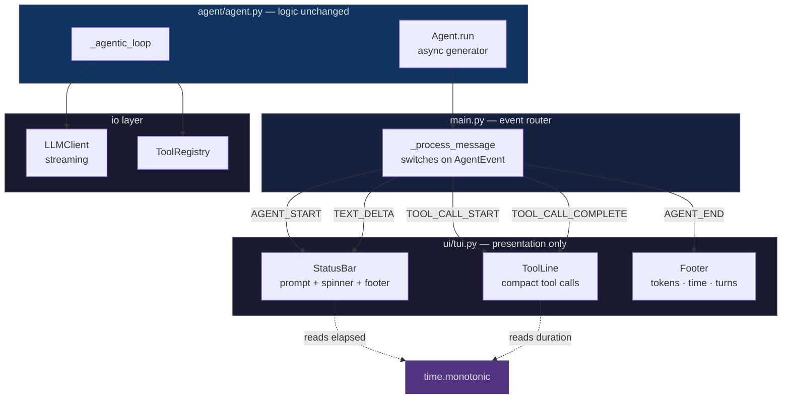

# TUI Target Design — Claude Code / OpenCode style

Reference mockup for the UI + latency rework. This is a **design artifact**, not
the current implementation.

## Problems this addresses

| Current | Problem |
|---|---|
| `[user]> ` prompt | Looks like a raw shell, not an agent |
| Nothing between submit and first token | Appears hung for up to 38s |
| Tool panel frozen at "running" | No progress signal |
| No timing anywhere | Can't tell fast from stuck |
| No turn/token awareness | Long sessions feel unbounded |
| ASCII borders + heavy panels | Noisy, low information density |

---

## 1. Prompt bar

Current — raw shell prompt, wastes a line, no state:

```
[user]> 
```

Target — inline, stateful, single line, shows budget:

```
  ❯ _                                        turn 3 · 4.7k/256k · 12.4s
```

While the agent works, the same bar becomes a live status strip:

```
  ❯ hi
  ⠋ Thinking… 12s
```

---

## 2. Full session mockup

```
  AI Agent · openai/gpt-oss-120b · /home/mehfooj/dev/ai-coding-agent

  ❯ list the python files in tools/

  ⠋ Thinking… 3s

  ⠹ read_file  tools/registry.py                      · 14ms
  ⠹ grep  "class .*Tool"  path=tools                   · 31ms

  Found 4 tool modules: base.py, registry.py,
  discovery.py, subagents.py. The Tool ABC in base.py is the
  extension point — every tool implements execute().

  ─────────────────────────────────────────────────────────
  turn 3 · 5.4k tokens · 41 cached · 2.1s              ⏎ send · ⌃C cancel

  ❯ _
```

Key changes vs. today:
- No bordered panel per tool — one compact line per call
- Status strip persists after the turn so you always see cost
- `⠋ Thinking… 3s` fills the dead air
- `⏎ send · ⌃C cancel` tells you what keys do

---

## 3. Event → visual mapping

| Event | Current | Target |
|---|---|---|
| `AGENT_START` | **dropped** | `⠋ Thinking… Ns` spinner starts |
| `TEXT_DELTA` | panel opens, streams | inline, streams in place |
| `TEXT_COMPLETE` | nothing | footer: turns · tokens · time |
| `TOOL_CALL_START` | full bordered panel, "running" | `⠹ <name>  <key args>  · …` |
| `TOOL_CALL_COMPLETE` | second full panel | `✔ <name>  · 14ms` |
| `AGENT_END` | **dropped** | clear spinner, print footer |
| compaction | **silent** | `⟳ context compacted` |

`AGENT_START` and `AGENT_END` are already emitted by `agent/agent.py` but have no
handler in `main.py`. That's the single cheapest fix.

---

## 4. Architecture



**Key point: the agent loop does not change.** `Agent.run()` already yields
`AGENT_START` / `AGENT_END` / tool events. This is purely a presentation-layer
rebuild on top of an event stream that already exists.

---

## 5. Timing model

One clock, three consumers:

```python
t0 = time.monotonic()   # at AGENT_START

# spinner      — repaint every 80ms with (now - t0)
# tool call    — t_call = monotonic() at TOOL_CALL_START
#                 duration = monotonic() - t_call  at COMPLETE
# footer       — total = monotonic() - t0  at AGENT_END
```

`monotonic()` not `time.time()` — immune to clock adjustments, and differences
are all that matter.

---

## 6. Success criteria

- [ ] Typing a message produces a visible response within 100ms
- [ ] Elapsed time is visible and ticking during every wait
- [ ] A tool call shows its duration when it finishes
- [ ] Prompt shows turn count and token usage
- [ ] `/exit`, `/clear`, `/help` still work
- [ ] Ctrl+C cancels cleanly mid-turn
- [ ] No ASCII box-drawing characters in the main flow
- [ ] Long tool output still truncated (existing `_max_block_tokens`)

---

## 7. Non-goals for this phase

- No streaming markdown rendering (Rich `Live` + `Markdown` later)
- No colour themes beyond current `AGENT_THEME`
- No mouse support
- No multi-line input editing (that needs `prompt_toolkit`)
